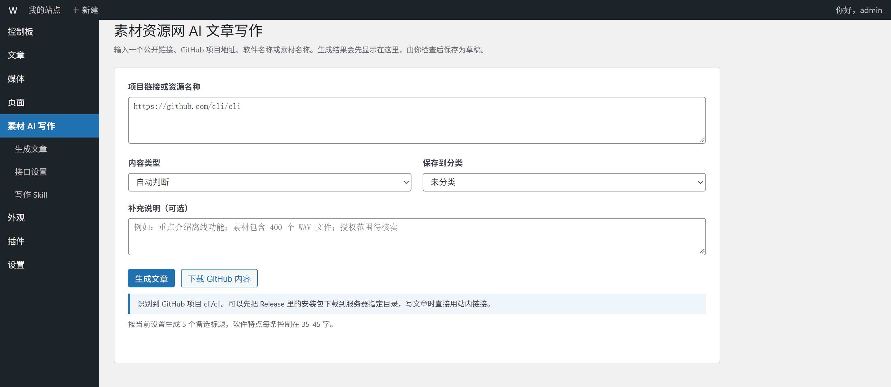
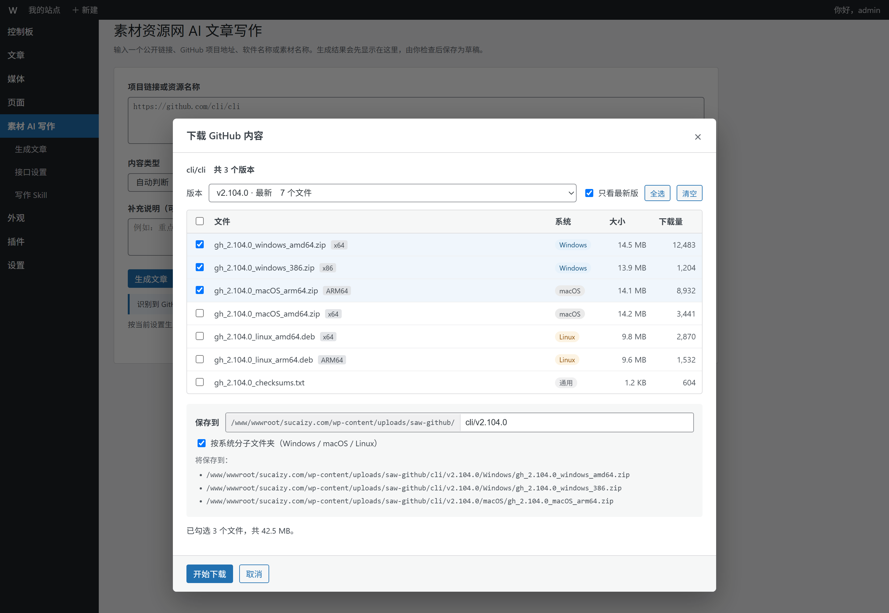
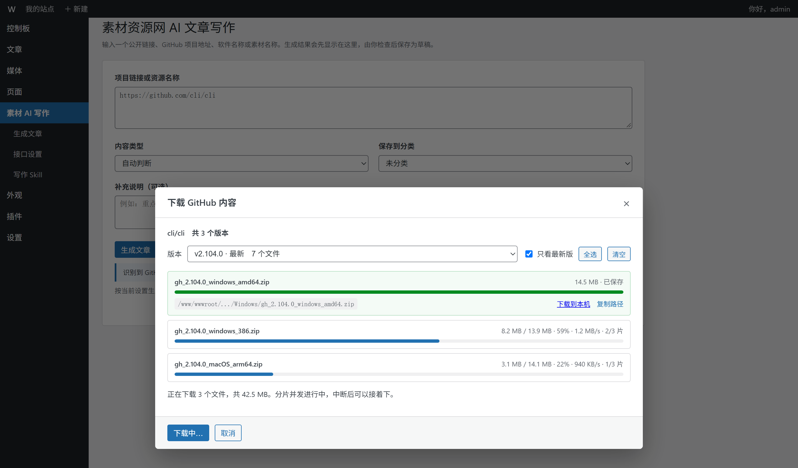
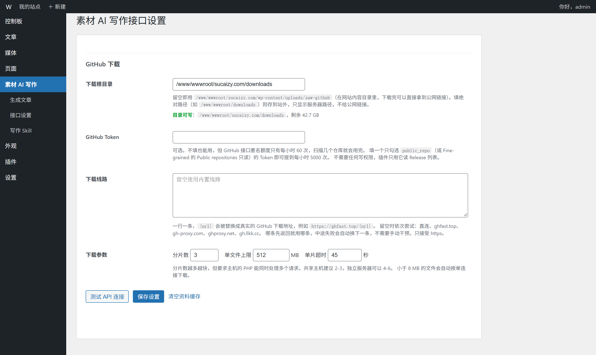

# 素材资源网 AI 文章写作

[](LICENSE)
[](https://wordpress.org/)
[](#环境要求)

一个把「找资料 → 写文章 → 存草稿」串成一条流水线的 WordPress 插件。输入一个公开链接、GitHub 仓库地址、软件名称或素材名称，插件会并发抓取网页、GitHub API、B 站视频和搜索结果，再把整理好的资料交给 AI 模型，按素材资源网的写作规范生成中文文章，校验字数后保存为草稿——**不会自动发布**。

生成和保存仅限管理员使用，API Key 只存在你自己的数据库里，不经过任何中间服务器。

---

## 它解决什么问题

写完一篇资源介绍类文章，真正费时间的不是打字，而是翻资料、凑字数、检查标题长度、确认没把「支持 Windows」写成「支持系统：Windows。」。这个插件把这几件机械活儿接了过去：

- **并发抓取**：网页正文、GitHub 元数据、最新 Release、B 站高播放视频、两路网页搜索同时发出，一轮请求内拿完，等待时间明显短于串行抓取。
- **模型只出 JSON**：标题、简介、栏目条目交给模型，排版、三级标题、栏目标题由 PHP 统一生成。输出更短，模型更不容易跑偏，也省钱。
- **字数硬校验**：标题 43–67 字、简介 100–180 字、特点每条 35–45 字，超出会在标点处收短，而不是硬截成半句话。
- **结果可核对**：面板里显示 token 用量、估算费用、抓取耗时、AI 耗时，以及「缺少资料支持的数字/平台/夸张表述」清单。

## 功能

| 能力 | 说明 |
| --- | --- |
| 多类型输入 | 公开网页、GitHub 仓库、软件名称、数字素材名称 |
| GitHub 信息 | 自动读取 Stars、许可证、主要语言、最新 Release |
| 参考检索 | 抓 B 站高播放视频与两路网页搜索的标题 + 文案摘要，学习选题角度后用自己的话重写（可关闭） |
| 标题 | 默认 5 个备选（3–10 可调），43–67 字，过滤超长、空洞夸张、不含资源名称的标题 |
| 简介 | 100–180 字，真人用过之后的推荐口吻，长短句交替 |
| 特点 | 固定 5–6 条，每条「标签：说明」35–45 字，软件类自动补「支持系统」 |
| 写作 Skill | 后台可视化编辑标题数量与长度、语气、简介字数、栏目顺序、特点写法，保存后下一篇立即生效 |
| 缓存 | 资料默认缓存 180 分钟，同一链接再次生成直接复用，后台可一键清空 |
| 换一批标题 | 只重做标题，正文不动，复用已缓存资料 |
| 前端投稿 | 在投稿页生成并写入普通表单、TinyMCE 或 contenteditable 编辑器；也可用短代码 `[sucaizy_ai_writer]` 嵌到任意页面 |
| 接口兼容 | OpenAI Responses API 与常见 OpenAI 兼容 Chat Completions 接口；DeepSeek 默认关闭思考模式省费用 |
| 环境自检 | 设置页直接列出 PHP 版本、json/openssl/mbstring/curl/dom 扩展状态和脚本超时 |
| GitHub 下载 | 识别到仓库地址后，可把 Release 安装包分片下载到服务器指定目录：多版本、按系统归档、多线路自动换线、断点续传，完成后给出站内链接 |

## 截图

在输入框贴上 GitHub 地址，「生成文章」右边会多出一个「下载 GitHub 内容」：



点开是 Release 列表，按系统分好类，勾选后填一个子目录，就能看到文件最终落在服务器上的完整路径：



下载是分片的，中断后重新点一次会接着下，不会从头开始：



下载根目录、Token、备用线路、分片数都在设置页的「GitHub 下载」里：



## 环境要求

- WordPress **6.4** 及以上
- PHP **7.2** 及以上（已在 **PHP 8.3** 下完整验证，含缺少 mbstring 的情况）
- 必需扩展：`json`、`openssl`、`curl`、`dom`
- 建议扩展：`mbstring`（缺失时自动改用 iconv 或内置算法，功能不受影响）
- 一个 OpenAI 兼容的 API：API Base、API Key、模型名

## 安装

1. 后台「插件 → 安装插件 → 上传插件」，上传 `sucaizy-ai-writer-x.y.z.zip`，启用。
2. 打开「素材 AI 写作 → 接口设置」，填写 API Key、API Base、模型、接口格式。
3. 点「测试 API 连接」。**必须测试通过才能生成**，配置改动后需要重新测试。
4. （可选）进入「写作 Skill」调整标题长度、语气、栏目结构。
5. 回到「素材 AI 写作」，贴链接或名称，生成 → 检查 → 保存为草稿。

从源码安装：把本仓库克隆或解压到 `wp-content/plugins/sucaizy-ai-writer/`，目录名和主文件名都不要改。

## GitHub 下载怎么用

1. 在「生成文章」上方的输入框里贴 `https://github.com/owner/repo`（或直接写 `owner/repo`），「下载 GitHub 内容」按钮就会出现。
2. 点开弹窗，选版本、勾文件。列表里已经按 macOS / Windows / Linux / 通用 分好，可以只勾某一列。
3. 「保存到」填一个子目录，比如 `cli/v2.104.0`，弹窗里会实时显示每个文件的完整落盘路径。
4. 点「开始下载」，分片并发跑完自动合并，完成后给出服务器路径；如果根目录在网站内容目录里，还会给出可直接引用的公网链接。

几个要点：

- **存哪里**：设置页「下载根目录」留空时存在 `wp-content/uploads/saw-github/`，下载完可以直接拿到链接写进文章；填 `/www/wwwroot/downloads` 这类绝对路径则存到站外，只显示服务器路径，不暴露给公网。
- **速度**：默认 3 个分片并发，共享主机建议 2–3，独立服务器可以 4–6。小于 8 MB 的文件自动按单连接下载，省掉合并开销。
- **下不动**：内置直连 + ghfast.top + gh-proxy.com + ghproxy.net + gh.llkk.cc 五条线路，探测后选最快的一条，中途失败自动换下一条。全部不通时在设置页「下载线路」里填自己的镜像，一行一条，`{url}` 会被替换成真实地址。
- **接口额度**：GitHub 匿名接口每小时 60 次，扫描几个仓库就用完。填一个只读 Token 可以提到 5000 次/小时，插件只用它读 Release 列表，不需要任何写权限。
- **安全**：下载地址只接受 GitHub 域名，路径逐段过滤 `..`，隐藏文件前缀会被剥掉；任务归属当前用户，别人的任务 ID 调用不到。单文件大小上限默认 512 MB，可在设置页调整。

## 升级注意

> **不要先删除旧版再装新版。** 删除时会执行 `uninstall.php`，API Key、接口设置和自定义写作 Skill 会被一并清空。

正确做法是「上传插件」后选**替换当前版本**，或用 FTP 覆盖 `wp-content/plugins/sucaizy-ai-writer/` 下的文件。

## 常见问题

**更新后白屏 / 提示「此站点遇到了致命错误」**
把 `wp-content/plugins/sucaizy-ai-writer` 重命名为 `sucaizy-ai-writer.disabled`，网站立刻恢复。重命名不会触发卸载脚本，设置都还在。

**提示「插件不存在」**
检查 `wp-content/plugins/` 下是否出现了嵌套目录（`sucaizy-ai-writer/sucaizy-ai-writer/`）。有的话把内层文件整体上移一层，删掉多余的目录。

**点生成没反应**
先看设置页底部的「运行环境自检」。PHP 8 对非法 UTF-8、null 传参比 7.x 严格，若主机开着 `display_errors`，告警文字会插进 AJAX 返回的 JSON 里导致解析失败。1.6.6 起所有 AJAX 响应都会先丢弃意外输出并写入 `error_log`。仍无反应时去 `wp-content/debug.log` 看有没有 `saw_` 开头的报错。

**中文变成 `½Øͼ¹¤¾ßÏÂÔØ` 这样的乱码**
这是 GBK/BIG5 站点被当成西欧编码解析。1.6.6 起会先探测编码、转成 UTF-8、改写页面 charset 声明后再解析，并已升级缓存版本强制重抓旧数据。

**标题 / 特点字数总是不达标**
模型本身不稳定，插件会自动在标点处收短并在结果里提示实际字数。想要更稳可以调低生成温度（见「接口设置」）或更换模型。

## 开发

```
sucaizy-ai-writer/
├── sucaizy-ai-writer.php      # 入口：常量、加载、激活钩子、重复安装保护
├── includes/
│   ├── class-saw-http.php     # 并发抓取（curl_multi）、编码处理、超时兜底
│   ├── class-saw-generator.php# 抓取编排、HTML 解析、提示词、调用模型、JSON 解析
│   ├── class-saw-quality.php  # 中文字数、断句收短、标点规范化、结构校验
│   ├── class-saw-github.php   # Release 扫描、线路探测、分片下载与续传、合并
│   ├── class-saw-admin.php    # 后台页面、设置、AJAX、环境自检
│   └── class-saw-frontend.php # 投稿页生成器、短代码
├── assets/                    # 后台与前端 CSS/JS
├── screenshots/               # README 截图
├── uninstall.php              # 卸载清理
├── readme.txt                 # WordPress 插件目录格式说明
└── CHANGELOG.md
```

本地只做语法检查就够用：

```bash
find . -name '*.php' -print0 | xargs -0 -n1 php -l
```

代码约定：4 空格缩进、不用 Tab；保持 PHP 7.2 语法兼容（不用箭头函数、`match`、构造器属性提升、命名参数）；所有输出走 `esc_html()` / `esc_attr()` / `esc_url()`；新加的 AJAX 动作必须 `check_ajax_referer()` + `current_user_can('manage_options')`。

## 安全

- API Key 存在 `wp_options`，设置页受 `manage_options` 权限保护，普通用户与投稿者看不到。
- 所有 AJAX 动作校验 nonce 与权限，未登录用户无法调用生成接口。
- 抓取内容仅用于拼提示词，写入文章的文本经过 `sanitize_*` / `wp_kses_post` 处理。
- 生成结果一律保存为**草稿**，不自动发布。

如果发现安全问题，请**不要**开公开 issue，直接发邮件给作者（见插件头 `Author URI`）。

## 许可证

[GPL-2.0-or-later](LICENSE)。你可以自由使用、修改、分发，包括商用；分发修改版时必须同样以 GPL 兼容许可证开放源码。

## 免责声明

本项目与 OpenAI、DeepSeek、哔哩哔哩、GitHub 均无关联。生成的文字由模型产出，事实准确性需自行核实——插件会列出「缺少资料支持的数字与平台」，但那只是提示，不是保证。请遵守目标站点的 robots 协议与版权规定。
